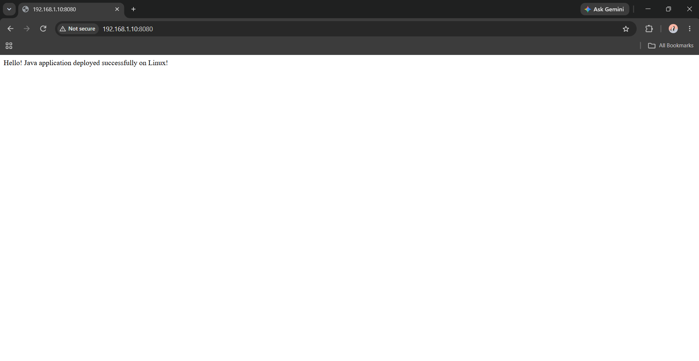
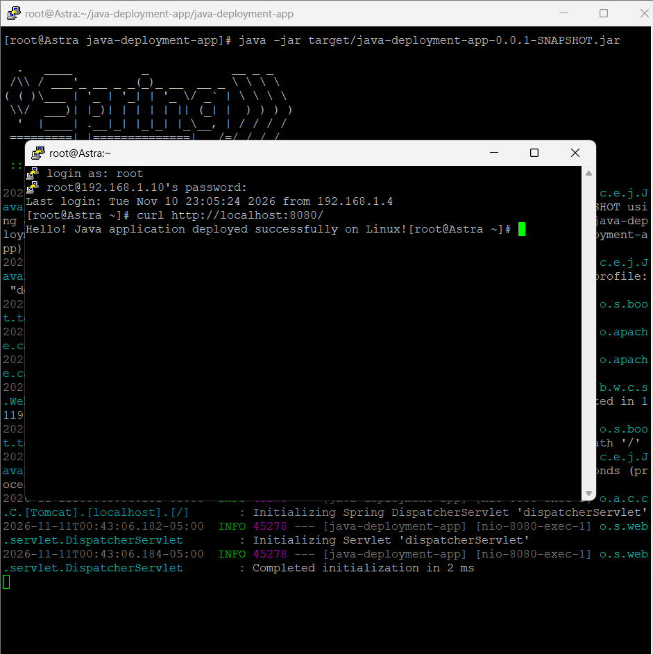

# Java Application Deployment on Rocky Linux 9.8

A hands-on Linux System Administration project demonstrating the manual deployment of a Java Spring Boot web application on Rocky Linux 9.8.

## Project Overview

This project demonstrates how to deploy a Java Spring Boot application on a Linux server using OpenJDK 21 and Apache Maven.

The application is packaged as an executable JAR, launched using the Java runtime, and made accessible over the network by configuring the Linux firewall.

The deployment was performed on a Rocky Linux 9.8 virtual machine using VMware Workstation, with the application accessed from a Windows host through Google Chrome.

## Technology Stack

| Technology | Purpose |
|---|---|
| Rocky Linux 9.8 | Server operating system |
| OpenJDK 21 | Java runtime and compiler |
| Spring Boot | Application framework |
| Apache Maven | Build and dependency management |
| Apache Tomcat | Embedded application server |
| firewalld | Linux firewall management |
| VMware Workstation | Virtualization |
| Git & GitHub | Version control |

## Deployment Architecture

```text
Windows Host (Chrome)
        |
        | HTTP :8080
        v
Rocky Linux 9.8 VM
        |
        v
firewalld (TCP 8080)
        |
        v
Embedded Apache Tomcat
        |
        v
Spring Boot Application
        |
        v
HTTP Response
```

## Project Structure

```text
java-app-deployment-rhel9/
├── .gitignore
├── README.md
├── screenshots/
│   ├── chrome.png
│   └── putty.png
└── java-deployment-app/
    ├── pom.xml
    ├── mvnw
    ├── mvnw.cmd
    └── src/
        ├── main/
        │   ├── java/
        │   └── resources/
        └── test/
```

## Implementation Steps

1. Prepared a Rocky Linux 9.8 virtual machine using VMware.
2. Installed OpenJDK 21 and Apache Maven.
3. Generated a Spring Boot application using Spring Initializr.
4. Created a REST endpoint using `@RestController` and `@GetMapping`.
5. Built the application using Maven.
6. Generated an executable JAR.
7. Started the application using `java -jar`.
8. Configured firewalld to allow incoming TCP connections on port 8080.
9. Verified the application using curl.
10. Accessed the deployed application through Chrome on Windows.

## Build the Application

```bash
mvn clean package
```

## Run the Application

```bash
java -jar target/java-deployment-app-0.0.1-SNAPSHOT.jar
```

## Firewall Configuration

```bash
firewall-cmd --permanent --add-port=8080/tcp
firewall-cmd --reload
firewall-cmd --list-ports
```

## Verify Deployment

Test locally on the Linux server:

```bash
curl http://localhost:8080/
```

Access from the Windows host:

```text
http://<VM-IP-ADDRESS>:8080/
```

Expected response:

```text
Hello! Java application deployed successfully on Linux!
```

## Deployment Screenshots

### Application Running in Chrome



### Application Running on Rocky Linux



## Skills Demonstrated

- Linux server administration
- OpenJDK installation and configuration
- Maven builds and dependency management
- Spring Boot application deployment
- Executable JAR execution
- Firewall configuration using firewalld
- HTTP troubleshooting and verification
- Git and GitHub version control

## Future Improvements

- Configure Nginx as a reverse proxy.
- Manage the application using systemd.
- Implement automated deployment.
- Introduce Docker and CI/CD.

---

**Project Status:** Manual application deployment completed successfully.
